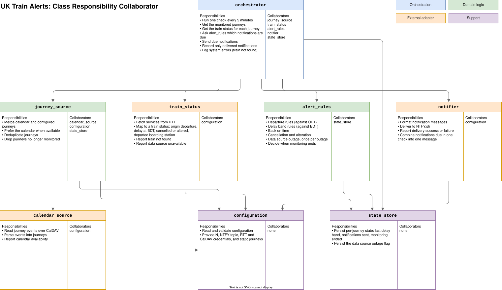
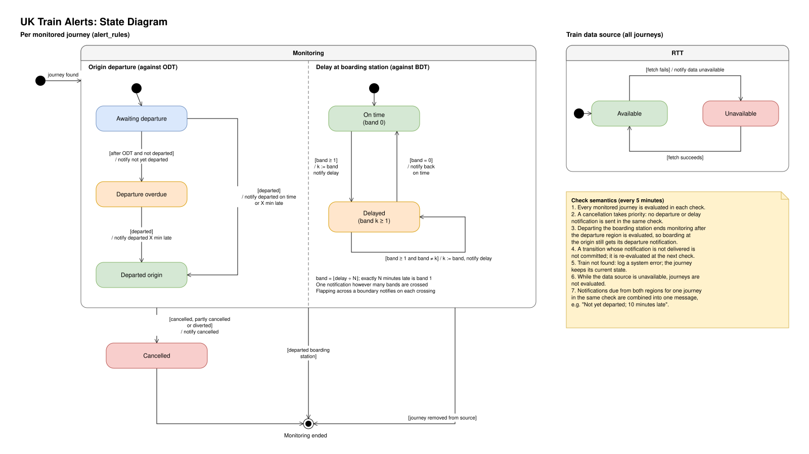
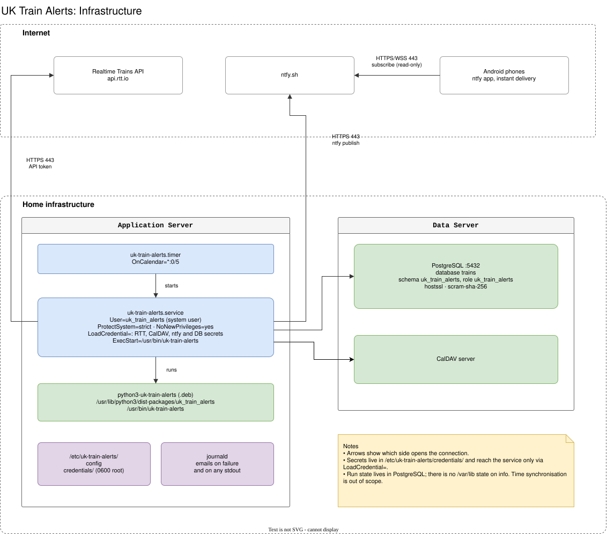

# Design

This explains how UK Train Alerts is meant to work and why. The behaviour is
specified precisely in the Gherkin scenarios in [`features/`](../features/),
which are the reference. This page is the overview.

The repository currently contains only a proof of concept,
`check_trains.py`. The design below is the target for the `train_alerts`
package that will replace it.

## The idea

A commuter or other train traveller plans particular journeys. The system
watches those trains and speaks only when something changes materially. The
traveller can then consider alternatives without having to seek out the
information, and silence means nothing has changed.

Every five minutes the system runs one check. For each monitored journey it
asks the Realtime Trains (RTT) API about the train, decides which
notifications are now due, sends them through ntfy, and records only the ones
that were delivered.

## What it tells you

Notifications fall into four groups:

- **Departure.** Whether the train left its origin on time, judged against the
  origin departure time (ODT), even if you board at a later stop. A train that
  has not left by its ODT is reported once, and again when it does leave.
- **Delay.** Delay at your boarding station, against the boarding departure
  time (BDT), in bands of N minutes. You are told whenever the band changes,
  including when the train is back on time. Changes within a band are not
  reported.
- **Cancellation.** A cancelled, partly cancelled or diverted train is
  reported as soon as it is seen, then no longer monitored.
- **Data outage.** If train data cannot be fetched, you are told once per
  outage.

Notifications due for one journey in the same check are combined into one
message.

## Where journeys come from

Journeys come from a calendar (CalDAV) when it is available, and from the
configuration otherwise. The calendar wins when the same train appears in
both.

## When monitoring ends

A journey is no longer monitored once the train has been cancelled, has
departed your boarding station, or has been removed from the calendar.

## Failures

- A notification is recorded as sent only once it is delivered. Otherwise it is
  due again at the next check.
- A train that cannot be found in the data is a system error. It is logged,
  and no notification is sent.

## Structure

Responsibilities are divided between small components, shown in the CRC
cards below: an orchestrator, a journey source, train status, alert rules, a
notifier, a calendar source, configuration and a state store. The alert rules
hold the decisions and have no network access. Everything that talks to the
outside world is an adapter, which is what lets the acceptance tests run
against fakes.

The state diagram shows the states a journey moves through and the rules for
each check.

## Deployment

The system runs as a systemd timer every five minutes on a home server,
installed from a Debian package. Run state is kept in PostgreSQL on a separate
server, and secrets are passed to the service as systemd credentials.

## Background

The [initial thoughts](initial_thoughts.pdf) pre-date this design.
